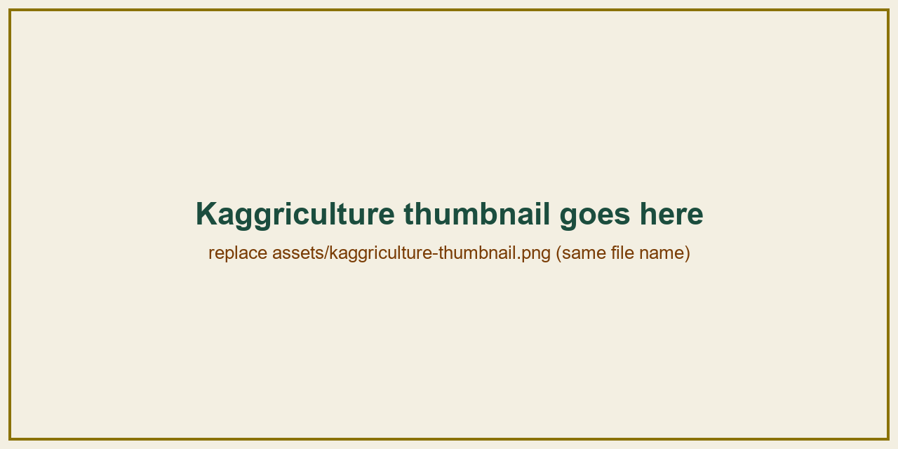
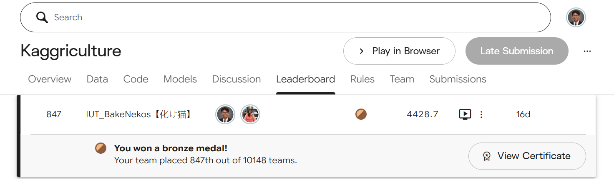
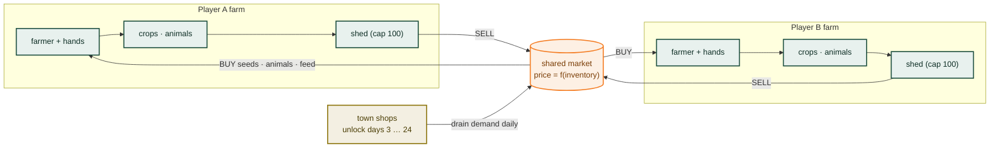
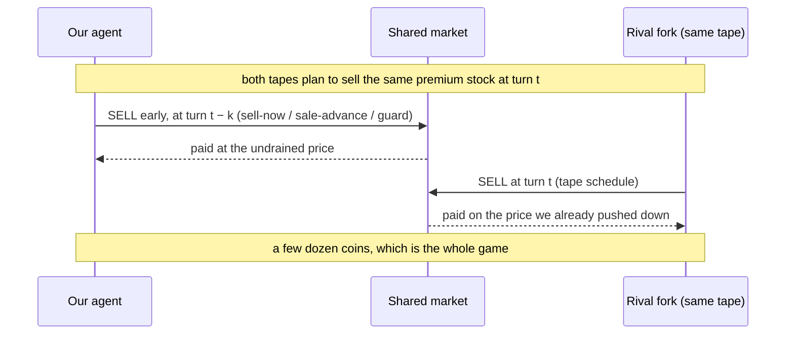
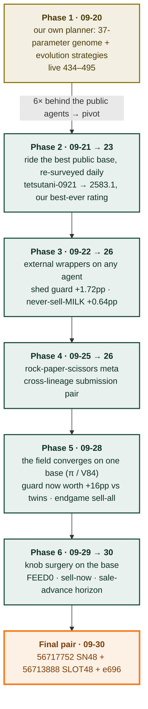
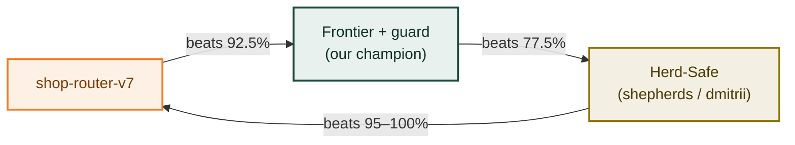
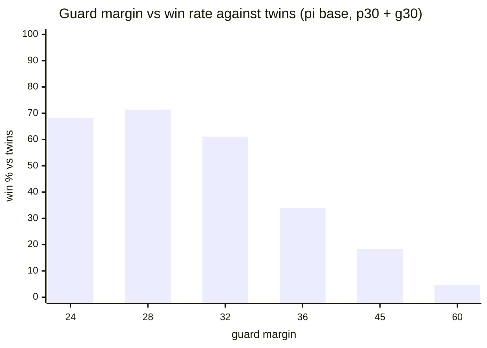
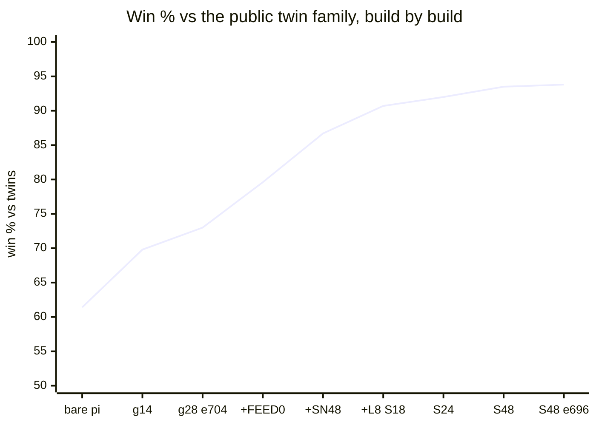
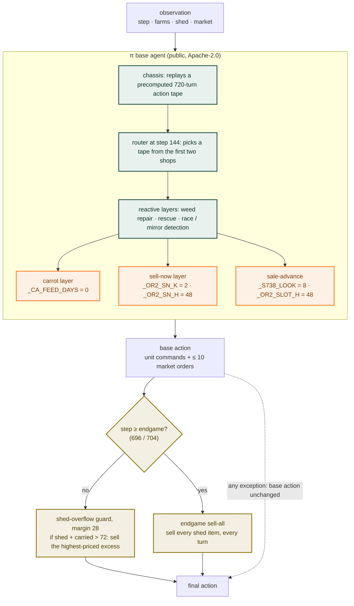

<div align="center">

# Team IUT_BakeNekos — Bronze Medal Solution

### Out-selling your own twin: measured wrappers and knob surgery on the public frontier farming agent

**Kaggriculture** — *a two-player, 720-turn farming and market simulation on Kaggle*

🥉 **Bronze Medal — Kaggriculture on Kaggle, 2026**

[](https://www.kaggle.com/competitions/kaggriculture)
[](#final-standing)
[](#1-the-game)
[](#final-standing)
[](#7-leaderboard-journey)
[](#10-reproducing-the-results)

<b><a href="https://www.kaggle.com/farhanishraqq">Md. Farhan Ishraq</a></b><sup>1</sup> &nbsp;·&nbsp; <b><a href="https://www.kaggle.com/didhitinahid">Didhiti Nahid</a></b><sup>1</sup>

<sub><sup>1</sup> Islamic University of Technology (IUT), Bangladesh<br>
Kaggle simulation competition <a href="https://www.kaggle.com/competitions/kaggriculture"><code>kaggriculture</code></a> · September 2026</sub>

<br>



</div>

---

> Two agents farm side by side for 30 in-game days and sell into **one shared market**. Whoever
> ends with more coins wins. Margin is ignored: a +1 coin win counts the same as a +50k win.
>
> We began by building our own planner, and it lost to the public agents by 6×. The competition
> turned out to be decided somewhere else. By the final week **most of the live field was running
> forks of a single public agent**, all replaying the same 720-turn action tape. A game between two
> such twins is decided by **3–50 coins out of ~100k**, and what decides it is not farming better.
> It is **selling ahead of the shared schedule**. Our final agent is the strongest public base plus
> a shed-overflow guard, an endgame sell-all, and five re-tuned constants. Each change was confirmed
> in a farm round of 100k+ paired games on fresh seeds.

<table>
<tr>
<td width="25%" align="center"><h3>~5.6M</h3>simulated games across ~50 Kaggle farm rounds</td>
<td width="25%" align="center"><h3>93.8%</h3>final build's win rate against the public twin family (bare base: 61.4%)</td>
<td width="25%" align="center"><h3>5 lines</h3>changed in a 1.2 MB public agent, plus a 93-line wrapper of our own</td>
<td width="25%" align="center"><h3>720 / 720</h3>official-runner validation, DONE/DONE, worst turn 68 ms of a 1 s budget</td>
</tr>
</table>

| | |
|---|---|
| **Outcome** | 🥉 **Bronze medal.** Final pair locked 2026-09-30 20:09 UTC; the final Bradley-Terry ranking comes from ~2 weeks of post-deadline games. See [Final standing](#final-standing) |
| **Final pair** | `56717752` **SN48** build (sha256 `77e854a4…`) + `56713888` **SLOT48 + e696** build (sha256 `b75d734a…`); both files are in [`submissions/`](submissions/) |
| **Base agent** | Aleksei Provorov's **π** (`c-pi-0927`), a member of the tetsutani Step1009 / Master Engine V4 lineage. Apache-2.0, all upstream notices retained |
| **Our layers** | shed-overflow guard (margin 28) · endgame sell-all (step 696 / 704) · `_CA_FEED_DAYS=0` · sell-now layer switched on (`_OR2_SN_K=2`, `_OR2_SN_H=48`) · sale-advance `_S738_LOOK=8`, `_OR2_SLOT_H=48` |
| **Evaluation** | bit-exact fast simulator + a Kaggle notebook farm (up to 65 CPU kernels plus GPU slots) + paired, both-seat games on fresh seed blocks + pre-registered ship rules |

### Final standing

<div align="center">



<sub>Final Kaggriculture leaderboard, team <b>IUT_BakeNekos</b>: bronze medal.</sub>

</div>

---

## Contents

**The argument**
&nbsp;&nbsp;[1. The game](#1-the-game) ·
[2. The finding that decided it: you are playing your own twin](#2-the-finding-that-decided-it-you-are-playing-your-own-twin) ·
[3. The journey](#3-the-journey) ·
[4. The final solution](#4-the-final-solution)

**The evidence**
&nbsp;&nbsp;[5. Evaluation infrastructure](#5-evaluation-infrastructure) ·
[6. What worked, and what we closed by measurement](#6-what-worked-and-what-we-closed-by-measurement) ·
[7. Leaderboard journey](#7-leaderboard-journey)

**The code**
&nbsp;&nbsp;[8. Repository layout](#8-repository-layout) ·
[9. Where to read what](#9-where-to-read-what) ·
[10. Reproducing the results](#10-reproducing-the-results) ·
[11. Hard-won lessons](#11-hard-won-lessons) ·
[12. Attribution and licences](#12-attribution-and-licences)

---

## 1. The game

| | |
|---|---|
| Board | two 10×10 farms side by side; three land quadrants start locked and can be bought |
| Length | **720 turns** = 30 days × 24 hours |
| Units | 1 farmer + hired hands; hiring the *n*-th hand costs `fib(n)` per day, reset daily |
| Products | crops (wheat, carrot, tomato, strawberry, melon), animals (goose → egg, cow → milk, sheep → wool), fertilizer |
| Market | **one market shared by both players and the town**; price is a function of inventory; orders fill one unit at a time, in lockstep across both players |
| Town | 8 shops unlock on days 3, 6, …, 24, drawn at random with replacement; each drains specific products every day |
| Win | most coins at turn 720; the rating is Bradley-Terry over win / loss / draw. **Margin is ignored** |
| Limits | 1 s per turn plus 60 s of overage per episode; a single `main.py`, **stdlib only**, no file reads, no network |
| Final ranking | only the **latest 2 submissions** are tracked; the team is ranked by the better of the two after ~2 weeks of post-deadline games |



**The engine source is the spec.** We pinned `kaggle-environments==1.32.7`'s engine to
[`engine/kaggriculture_ref.py`](engine/kaggriculture_ref.py) and verified every mechanic below
against it. The official docs ([`kaggriculture/`](kaggriculture/)) are accurate but incomplete.

| Product | Units you can dump before the price hits $1 | What that means |
|---|---|---|
| EGG, WHEAT | effectively unlimited (log glut curve) | never crash; goose output is bounded only by labour |
| CARROT, TOMATO | 842 / 529 | **hinge scarcity curve**: town shops drain them for free, and if nobody grows them the price runs away quadratically |
| MELON | 158 | race the opponent to sell them |
| MILK, WOOL, STRAWBERRY | 76 / 59 / 62 | **traps**: after ~60–80 units the price sits at $1 permanently |
| FERTILIZER | 493 | the town never buys it, so its inventory only grows; sell early or not at all |

Rules that silently kill agents:

- A new plant starts one day unwatered. Not watering it on planting day kills it that night.
- The shed holds **100 items including produce**. Overflow at the end of the day is **discarded** without warning.
- Max 10 market orders per turn; extras are silently dropped. Orders must be lists, `["SELL", item, qty]`. Any other shape is dropped **without an error**.
- **Labour, not land or cash, is the binding constraint.** 11 units cost $143/day; 15 cost $1,596.

The full table, with prices after town drain, is in [CLAUDE.md](CLAUDE.md#engine-facts-that-decide-the-game).

## 2. The finding that decided it: you are playing your own twin

The top of the public leaderboard was **one shared lineage of open-loop action tapes**. A chassis
replays a precomputed 720-turn action list, a router picks a tape at step 144 from the first two
unlocked shops, and its authors stack dozens of reactive wrapper layers on top.

We replayed our own live games with every candidate agent in the opponent's seat
([`runs/opp_id.py`](runs/opp_id.py)). **23 of 30 live opponents were our own lineage.** They shared
our tape to the turn and diverged at a median of step 150, right after the router branch. By
2026-09-28 the public field had converged further: four notebooks shipped **one byte-identical
file**, and a fifth (π) differed from it by a single constant.

Twins play the same farm. Their games are decided by **3–50 coins out of ~100k**, the results are
seat-symmetric, and the win rate becomes hypersensitive to tiny edges. Orders resolve **one unit at a
time, in lockstep, at the shared current price**, so the edge goes to **whoever sells first**:



That is why the same shed guard was worth **+1.7pp** against a mixed field but **+16pp** against
twins. Shed discards turned out *not* to be the mechanism. The guard won by selling ahead of the
twin. Every lever that paid in the final week is a variation on that theme.

## 3. The journey



### Phase 1: our own planner (abandoned)

End-to-end deep RL would not converge on CPUs in 10 days. The reward is a single scalar at turn 720,
and the action space is factored across ~12 units × ~17 operations plus a 10-slot market queue. So we
built **blackbox policy search**: evolution strategies over a parameterized planner (a 37-parameter
economics genome driving a greedy task scheduler), run as 20 Kaggle islands. All 20 islands converged
to **$87–100k vs the starter agent**. The public agents made **$185–196k** in the same matchup, and our
two live submissions rated 434 and 495. We had set a kill criterion for this case in advance, and we
followed it: fork and improve the public frontier instead.

The infrastructure built in this phase, the fast simulator and the Kaggle farm, is what the rest of
the project ran on.

### Phase 2: ride the best public base

We assembled a panel of 80+ runnable public agents, extracted from notebooks (three embedding styles:
`gzip+b64`, `zlib+b85` and plain `%%writefile`; AST-based, written as bytes because several agents pin
a SHA over their own source) and from a community donor library, and ranked them by round-robin. Submitted unmodified, **tetsutani-0921 rated
2583.1**, our best-ever number, though on the 09-21 scale (see [§7](#7-leaderboard-journey)). Tuning
the tape from outside did not work: every change to the opening was catastrophic, because the
720-turn tape is funded to the exact coin from turn 0.

### Phase 3: external wrappers

[`opt/shed_guard.py`](opt/shed_guard.py) wraps **any** agent without touching its internals. It runs
the base agent's action unchanged, projects end-of-day shed plus carried inventory, and if that would
exceed the cap minus a margin, it appends SELL orders for the highest-priced excess. Because it needs
no access to the base's code, it works on agents that are obfuscated six layers deep (koshinm:
**+2.86pp, z=8.12**).

On the Frontier base: **guard margin 14 +1.72pp (z=18.78, 98,671 paired games)**, and **never sell
MILK +0.64pp (z=9.47, 181,478 fresh-seed games)**. Milk floors at $1 after ~76 units, so spending it
to clear shed space destroys more value than bulk goods do. The effect is item-specific: skipping
STRAWBERRY instead is −1.84pp.

### Phase 4: the meta is rock-paper-scissors



No single agent covered the cycle, so for a while the tracked pair was deliberately **two different
lineages** (`56558912` Frontier + guard + skip-MILK, `56558917` Herd-Safe + guard). Two builds of one
family can be swept together by whichever counter appears.

### Phase 5: the field moved to one base

On 09-28 the public field converged on the V84 / Master Engine V4 file (sha `63dde9e4`), with π as its
strongest variant. Over **491,683 games** (n28), our old Frontier champion won only **16.6%** against
these twins. Against the same twins, bare π won 61.4% and π with the guard won **69.8%**: the guard
was worth ~10× more here than on Frontier. A new **endgame sell-all** (from step *E*, sell every shed item every turn) added **+6.3pp**
(526,867 games). The guard margin moved to 28, just below a cliff:



A wheat reserve in the guard collapsed it to 44–50%. The guard's early wheat sales **are** its edge;
it never wins by starving the herd.

### Phase 6: knob surgery on the base

The π file has hundreds of top-level constants. We built runtime variants
(`name@KNOB=VALUE`, assigned exactly once) and screened ~50 of them on the farm. **40 of 48 were
bit-identical to the reference** (dormant code paths). Three families moved the needle, each with a
monotonic dose-response:

| Knob | Default → shipped | What it does | Evidence |
|---|---|---|---|
| `_CA_FEED_DAYS` | 1 → **0** | the carrot layer stops holding wheat feed in reserve before switching a planting to carrots (hinge scarcity pricing) | dose 0 / 1 / 2 = **79.6 / 71.8 / 53.0%** vs twins; confirmed on two fresh blocks (p36, p38) |
| `_OR2_SN_K`, `_OR2_SN_H` | 0, 24 → **2, 48** | **sell-now**: when the rival is seen holding ≥ K units of a premium item, pull our tape's planned sales of it within H turns forward to now. *Its authors shipped it disabled* | **86.7%** vs twins; head-to-head **84.5% (z=17.6)** vs our previous submission (p40, 170,917 games) |
| `_S738_LOOK`, `_OR2_SLOT_H` | 4, 6 → **8, 48** | how far ahead already-stocked sales are advanced, and the sale-advance horizon when the order list is full | SLOT_H 12 → 18 → 24 → 48 each won head-to-head (80.1%, 66.6%, 64.5%); 30/36 flat, 42 worse: **48 = two full days of tape sales** is a sharp optimum |

Progression of the build against the twin family, one fresh-seed farm round per point
(g = guard margin, SN48 = sell-now, L8 = `_S738_LOOK=8`, S*n* = `_OR2_SLOT_H=n`):



**The final-day lesson.** Each new build beat its predecessor's exact config 59–85% head-to-head on
the farm. Live, they all settled around the same rating (SN48 ~2004, SLOT18 ~1977, SLOT24 ~1930). The
farm panel is mostly twins, and it **overstated live gains**. The live field also held a minority of
economically stronger, non-twin agents that timing changes cannot beat. So with the last submission
of the competition, we re-submitted the **live-proven SN48 file** as a hedge next to the strongest
farm build.

## 4. The final solution



<sub>Green: the public base, 1.2 MB, unmodified except five constants. Orange: the constants we re-tuned
inside it. Olive: our own wrapper, appended after the base's code. The internal layer order is simplified.</sub>

The two tracked builds differ by three lines:

| | **Final 1: `56717752` "SN48"** | **Final 2: `56713888` "SLOT48 + e696"** |
|---|---|---|
| File | [`submissions/final-1_sn48/main.py`](submissions/final-1_sn48/main.py) | [`submissions/final-2_slot48-e696/main.py`](submissions/final-2_slot48-e696/main.py) |
| sha256 | `77e854a4373f3928306ada5e5780dd6a`<br>`316b3946277c4f3f4c4c8162175f083e` | `b75d734a3863e5286f9a7c393c389333`<br>`82dd7b353721d68d6e85940a5c5e0a7f` |
| `_CA_FEED_DAYS` | **0** (was 1) | **0** |
| `_OR2_SN_K` / `_OR2_SN_H` | **2 / 48** (were 0 / 24) | **2 / 48** |
| `_S738_LOOK` | 4 (default) | **8** |
| `_OR2_SLOT_H` | 6 (default) | **48** |
| Guard margin | 28, no skip list | 28, no skip list |
| Endgame sell-all from | step 704 | step **696** |
| Farm evidence | 86.7% vs twins, 84.5% h2h vs its predecessor (p40) | **93.8%** vs twins, 58.7% h2h vs SLOT48 e704 (z=9.5), **88.3% h2h vs SN48** (p47) |
| Why it is in the pair | **live-proven hedge**: first submitted as `56686173`, peaked 2076, settled ~2004 | **strongest farm build** |
| Runtime variant name | `guard:c-pi-0927@_CA_FEED_DAYS=0@_OR2_SN_K=2@_OR2_SN_H=48:28:e704` | `guard:c-pi-0927@_CA_FEED_DAYS=0@_OR2_SN_K=2@_OR2_SN_H=48@_S738_LOOK=8@_OR2_SLOT_H=48:28:e696` |

Every modified constant is marked in place (`# modified 2026-09-30: was …`). Our wrapper is appended
after the base, and it reassigns `agent` so it is the last callable in the file. Abridged:

```python
_GUARD_ENDGAME = 696   # from this step: sell ALL shed stock each turn

def _guard_apply(obs, action, margin=28, min_price=2, skip=None):
    ...
    total = sum(shed.values()) + carried     # shed + what hands carry + this turn's harvests
    excess = total - 100 + margin            # shed cap is 100; overflow is discarded at day end
    if excess <= 0:
        return action
    # sell the highest-priced items not already being sold, within the 10-order cap
    ...
    return dict(action, market=orders + extra)   # builds a new action, never mutates the observation

_GUARD_BASE_AGENT = agent

def agent(observation, configuration=None):
    action = _GUARD_BASE_AGENT(observation, configuration)
    try:
        if observation["step"] >= _GUARD_ENDGAME:
            return _guard_apply(observation, action, margin=1000, skip=())   # endgame: sell everything
        return _guard_apply(observation, action)
    except Exception:
        return action                        # fail safe: the base agent's own action, unchanged
```

Both files passed every ship gate. Each baked file reproduces its evaluated runtime variant **to the
coin** on fixed seeds ([`runs/verify_bake.py`](runs/verify_bake.py)), and each passed a full episode in
the official `kaggle_environments` runner: 720 steps, DONE/DONE, worst turn 68 ms (re-checked
2026-10-08 on the committed file).

## 5. Evaluation infrastructure

```mermaid
flowchart LR
    S["daily Code-tab survey<br/>kaggle kernels list"] --> F["pull the exact<br/>submitted files<br/>runs/fetch_out.py"]
    F --> H["sha256<br/>hash-dedupe"]
    H --> SM["smoke + leak probe<br/>smoke.py · discard_probe.py"]
    SM --> V["runtime variants<br/>name@KNOB=VALUE<br/>guard:BASE:M:eSTEP"]
    V --> FARM["Kaggle farm<br/>fastsim · paired seeds<br/>both seats"]
    FARM --> P["paired deltas + z<br/>opt/paired.py"]
    P --> R{"pre-registered<br/>rules pass?"}
    R -->|"yes"| B["bake + verify<br/>bake_guard.py<br/>verify_bake.py"]
    B --> VAL["official runner<br/>720/720 DONE<br/>latency"]
    VAL --> SUB["submit"]
    R -->|"no"| CL["closed, with its<br/>number, in PLAN.md"]

    classDef io fill:#FDF0E4,stroke:#F47B20,stroke-width:2px,color:#7A3D06
    classDef core fill:#E8F1EE,stroke:#1B4D3E,stroke-width:2px,color:#0F2F26
    classDef gate fill:#F3EFE2,stroke:#8A7208,stroke-width:2px,color:#4A3D04
    class S,F,H,SM io
    class V,FARM,P core
    class R,B,VAL,SUB,CL gate
```



| Component | What it does |
|---|---|
| [`engine/fastsim.py`](engine/fastsim.py) | the engine re-implemented over plain dicts and lists: no schema validation, no observation serialization. The official runner takes 1–3 s per game; fastsim runs **73 games/s** locally for light agents. The 1 MB public agents themselves cost ~0.7 s per game, so the farm exists for them |
| [`engine/test_parity.py`](engine/test_parity.py) | **the gate**: random action streams through both engines, full state digest compared at every step, three agent pairings per seed. Run after every engine edit |
| [`scripts/kfarm.py`](scripts/kfarm.py) | Kaggle notebook farm. Each worker is one self-contained `.py` with the engine bundled (no pip, no dataset, no internet). 5 concurrent CPU sessions per account, plus GPU-session slots; a 40-shard × 2 h round yields ~150–300k games |
| [`opt/worldeval.py`](opt/worldeval.py) · [`opt/paired.py`](opt/paired.py) | paired evaluation: every seed played from both seats; deltas and z-scores from the jsonl; seed-clustered standard errors |
| [`opt/opponents.py`](opt/opponents.py) | loads any panel agent and builds any knob or wrapper combination **by name**, without writing a file |
| [`runs/opp_id.py`](runs/opp_id.py) · [`runs/livediag.py`](runs/livediag.py) · [`runs/h2h.py`](runs/h2h.py) | live forensics: replay our live games with candidates in the opponent's seat to identify who we actually play |
| [`scripts/bake_guard.py`](scripts/bake_guard.py) → [`runs/verify_bake.py`](runs/verify_bake.py) → [`scripts/build_submission.py`](scripts/build_submission.py) | ship gates: bake, prove coin-identical to the evaluated variant, validate in the official runner |

**Ship rules, pre-registered from round p36 on.** A candidate replaces the incumbent only if, on a
**fresh seed block never used for discovery**: (1) it beats the twin field by more than the incumbent
does, (2) it wins head-to-head against the incumbent's exact config with z > 3, and (3) it does not
lose ground against the broad field. The opponent field is always **fixed and disjoint from the
candidate list**.

## 6. What worked, and what we closed by measurement

**Worked**

| Lever | Gain | Evidence |
|---|---|---|
| Daily re-survey and base swaps | ~15pp per base swap, against ~2pp for wrappers | [progress.md](progress.md) §1 |
| Shed-overflow guard, margin 14 (Frontier era) | +1.72pp, z=18.78, 98,671 paired games | [PLAN.md](PLAN.md) 09-25 |
| Never sell MILK (Frontier era) | +0.64pp, z=9.47, 181,478 games | [PLAN.md](PLAN.md) 09-25 |
| Guard on an obfuscated agent (koshinm) | +2.86pp, z=8.12, n=7,240 | [PLAN.md](PLAN.md) 09-22 |
| Guard on the π twin field | 61.4% → 69.8% vs twins (n28, 491,683 games) | [PLAN.md](PLAN.md) 09-28 |
| Endgame sell-all | +6.3pp vs twins (p29, 526,867 games) | [PLAN.md](PLAN.md) 09-29 |
| `_CA_FEED_DAYS` 1 → 0 | +7.8pp vs twins, confirmed on two fresh blocks | [PLAN.md](PLAN.md) 09-29 |
| Sell-now layer (`_OR2_SN_K=2`, `_OR2_SN_H=48`) | 86.7% vs twins; 84.5% h2h (z=17.6) | [PLAN.md](PLAN.md) 09-30 p40 |
| Sale-advance (`_S738_LOOK=8`, `_OR2_SLOT_H` 18 → 24 → 48) | 80.1% → 66.6% → 64.5% h2h, each step against its predecessor | [PLAN.md](PLAN.md) p43–p46 |
| Endgame from step 696 on SLOT48 | 58.7% h2h (z=9.5); 93.8% vs twins | [PLAN.md](PLAN.md) p47 |

**Closed by measurement.** Each has its own record, so nobody walks the same dead end twice:

| Idea | Result |
|---|---|
| Our own policy from scratch (ES over a 37-parameter genome) | plateaued ~6× behind the public agents; live 434–495 |
| Retuning the public tape's opening | catastrophic, most variants to 0%: the tape is funded to the exact coin |
| Cross-family routing between agents | oracle +5.2pp but **unreachable**: candidates diverge at step 0, so there is nothing to route on |
| Cheap-first sell ordering in the guard | −1.89pp (z=−14.61), 153,359 games |
| Sale-advance / opponent-dump forecast wrapper | −2.9 to −28.8pp, worse with more lead |
| Idle-worker layer | +$7/game: the units are parked on purpose, not idle |
| Wheat speculation | 8.3% vs 100% |
| Fertilizer front-running | −3,308 coins; the rival *gained* ~$2.8k (the base also buys fertilizer) |
| Hour-gating the guard | h6 49.2% vs 73.0% ungated: its value is right after the day tick |
| Wheat reserve inside the guard | collapses to 44–50% |
| The base's race knobs (`_RACE_HORIZON_*`, `V9_RACE_*`, `_SR_MARGIN`, …) | all null over 163,053 games |
| ~50 other base constants | 40/48 bit-identical (dormant); the rest null or worse |
| Time-based seed cutoffs | −7 to −55pp |
| Within-turn best response to the twin's predicted orders | fires once per game, deleted |
| Shop steering (a legal DIG before a shop unlock) | directed control only 10–18%; parked |

Noise floor: anything under ~2k paired games counts as **unmeasured**. One complement lever read
+4.00pp (z=3.03) at n=375 and settled at −3.50pp over 88k games.

## 7. Leaderboard journey

**Ratings drift down as the field strengthens, so numbers from different days are not comparable.**
We measured this by re-submitting byte-identical files:

| File | First reading | Re-submitted later | Drop |
|---|---|---|---|
| tetsutani-0921 (sha `9c0a8921`) | 2583.1 (09-21) | 2192.5 (09-23) | −391 |
| dmitrii Herd-Safe (sha `4889137f`) | 2478.5 (09-24) | 1970.3 (09-25) | −508 |
| Frontier-0922 (sha `bc80b476`) | 2383.0 (09-23) | 1779.1 (09-25) | −604 |

| Date | Submission | Agent | Live rating* |
|---|---|---|---|
| 09-20 | `56405251` / `56406056` | our own ES planner | 434 / 495 |
| 09-20 | `56406154` | public fork-2801 | 1934.8 |
| 09-21 | `56442774` | tetsutani-0921, unmodified | **2583.1** (best ever, 09-21 scale) |
| 09-22 | `56470642` | dmitrii Herd-Safe | 2478.5 |
| 09-23 | `56502435` | Frontier-0922 | 2383.0 |
| 09-24 | `56508972` | Frontier-0923 + guard 14 | 2180.3 |
| 09-25 | `56558912` + `56558917` | cross-lineage pair: Frontier + guard + skip-MILK / Herd-Safe + guard | 2016.2 / 2029.7 |
| 09-28 | `56648604` | π + guard 14 + skip-MILK | ~1930–1970 |
| 09-29 | `56680502` | π + FEED0 + guard 28 + e704 | ~1781 |
| 09-29 | `56686173` | + sell-now (SN48) | peak 2076, settled ~2004 |
| 09-30 | `56701685` / `56706672` / `56710794` | + LOOK8 + SLOT 18 / 24 / 48 | ~1977 / ~1933 / ~1826 at eviction |
| 09-30 | **`56713888`** | **SLOT48 + e696** (final 2/2) | final |
| 09-30 | **`56717752`** | **SN48, re-submitted** (final 1/2) | final |

<sub>* Each rating was read at a different age and on a different day. Read them for shape, not
comparison. Last pre-deadline snapshot (09-30 19:27 UTC): team rank 1,094 of 10,225, while the whole
ladder fell ~190 points in two days. The final ranking comes from the post-deadline games; see
<a href="#final-standing">Final standing</a>.</sub>

## 8. Repository layout

```
.
├── README.md                ← you are here
├── progress.md              current-state handoff: submissions, ratings, what works, what is closed
├── PLAN.md                  dated experiment log, 09-21 → 09-30: every farm round, every number
├── CLAUDE.md                engine facts, hard constraints, daily ritual, measurement rules
├── assets/                  competition thumbnail and final leaderboard screenshot
├── submissions/             the two final submitted main.py files, byte-exact (Apache-2.0 derivatives)
│   ├── final-1_sn48/        56717752
│   └── final-2_slot48-e696/ 56713888
│
├── kaggriculture/           official README.md / AGENTS.md
├── engine/                  pinned reference engine · fastsim · parity gate · benchmark
├── opt/                     evaluation and research code
│   ├── opponents.py         agent loader + runtime variant naming (name@KNOB=VALUE, guard:…)
│   ├── worldeval.py         paired evaluation        paired.py     deltas + z from jsonl
│   ├── shed_guard.py        SHIPPED wrapper          sweep_eval.py knob sweeps
│   ├── sale_advance.py · idle_work.py · trader.py    measured negatives, kept as evidence
│   ├── leftover.py · live_gap.py · analyze.py        diagnostics
│   └── policy.py · search.py · evaluate.py           Phase 1: our own genome planner + ES
├── scripts/                 kfarm (farm) · bake_guard / bake_variant (ship) · build_submission (gate)
│                            extract_agents · fetch_notebooks · panel_dataset
├── agents/                  Phase 1 planner submission (main.py) + an early public fork
└── runs/                    probes and forensics (opp_id, h2h, livediag, discard_probe, verify_bake, …)
                             and farm round definitions (*_cands.txt, *_opps.txt)
```

**Not in git, on purpose:** API tokens (`Secrets.env`), the 8.8 GB of community datasets (`data/`),
the 134 MB of public agents used as the opponent panel (`opponents/`, re-fetchable with
`runs/fetch_out.py`), and ~2 GB of farm outputs.

## 9. Where to read what

| Question | Read |
|---|---|
| What is the current state, and what would we do next? | [progress.md](progress.md) |
| What was tried, in what order, and what did each round measure? | [PLAN.md](PLAN.md) |
| How does the engine actually work? Which mechanics kill agents? | [CLAUDE.md](CLAUDE.md) · [`engine/kaggriculture_ref.py`](engine/kaggriculture_ref.py) |
| How is an agent evaluated, and how do I name a variant? | [`opt/opponents.py`](opt/opponents.py) · [progress.md](progress.md) §10 |
| What exactly did we ship? | [`submissions/`](submissions/) · [§4](#4-the-final-solution) |
| Which mistakes cost us time? | [§11](#11-hard-won-lessons) · [progress.md](progress.md) §8 |

## 10. Reproducing the results

### 10.1 Run a final agent in the official runner

```bash
pip install kaggle-environments==1.32.7
python -c "import sys; sys.path.insert(0, 'scripts'); from pathlib import Path; import build_submission as b; print(b.validate(Path('submissions/final-2_slot48-e696/main.py')))"
```

This plays a full 720-step episode against the starter agent and checks DONE/DONE and per-turn latency.

### 10.2 Verify the simulator

```bash
python engine/test_parity.py      # fastsim == official engine, full state digest at every step
python engine/bench.py            # throughput
```

### 10.3 Rebuild a final file from the public base

```bash
python runs/fetch_out.py leoprovorov/31415926535897932384626433832795058202884197169399   # π, sha 836cbfb6…
cp runs/newout/31415926535897932384626433832795058202884197169399/main.py opponents/c-pi-0927.py
# edit the five constants listed in §4 into a copy, e.g. runs/base_pi_fs48.py, then append the guard:
python scripts/bake_guard.py runs/base_pi_fs48.py 28 --endgame 696 --out runs/sub_pi_fs48_g28_e696/main.py
python runs/verify_bake.py runs/sub_pi_fs48_g28_e696/main.py "guard:c-pi-0927@_CA_FEED_DAYS=0@_OR2_SN_K=2@_OR2_SN_H=48@_S738_LOOK=8@_OR2_SLOT_H=48:28:e696" c-mengine-0928
diff runs/sub_pi_fs48_g28_e696/main.py submissions/final-2_slot48-e696/main.py   # only comments/dates should differ
```

`fetch_out.py` uses the Kaggle CLI with a token from `Secrets.env` (see `scripts/kfarm.py`).

### 10.4 Evaluate candidates on the farm

```bash
python scripts/panel_dataset.py                                    # push the opponent panel to every account
python scripts/kfarm.py worldeval 120 5 11000000 "$(cat runs/p47_cands.txt)" "$(cat runs/p47_opps.txt)" p47
python runs/wait_tags.py p47                                       # poll to completion
python scripts/kfarm.py harvest_we p47                             # → runs/p47_all.jsonl
python opt/paired.py "guard:c-pi-0927@_CA_FEED_DAYS=0@_OR2_SN_K=2@_OR2_SN_H=48@_S738_LOOK=8@_OR2_SLOT_H=48:28:e704" runs/p47_all.jsonl
```

## 11. Hard-won lessons

Each of these cost real time or real rating:

1. **Ratings drift down as the field strengthens.** The same bytes scored 2583 and then 2192 two days
   later. Compare agents at the same age, or not at all.
2. **Money against a passive opponent is the wrong metric.** One agent posted $198,166 against the
   starter, the highest we ever measured, and lost to us by 12.4pp over 162k games.
3. **The opponent field must be fixed and disjoint from the candidates.** Including a candidate's own
   base credits it for beating its mirror; that turned a true +2.48pp into a reported +4.34pp.
4. **Under ~2k paired games is unmeasured.** Sign flips at small n were common; every large sample agreed.
5. **A delta of exactly 0.00 means your layer is not running.** Dict-shaped market orders are dropped
   silently; 8 variants and 8,320 games measured nothing.
6. **Discover and confirm on different seed ranges.** Everything shipped was confirmed on a fresh block.
7. **Hash-dedupe before testing.** Four notebooks once shipped one identical file.
8. **Never mutate the observation.** fastsim hands agents the live state; `shed[item] -= n` grants free goods.
9. **Buy `min(need, affordable)`, never all-or-nothing.** One all-or-nothing line starved a herd and
   took a $20k farm to $1k.
10. **Farm head-to-heads between your own builds overstate live gains.** Keep a live-proven build in
    the final pair as a hedge.
11. **Windows:** `pathlib.write_text()` without `encoding="utf-8"` corrupts sources, and
    `multiprocessing` spawn re-imports `__main__`, so pools live in real files.

## 12. Attribution and licences

The public agents in this competition are **Apache-2.0**. Our submitted files embed the π agent
**unmodified except five constant lines**, each marked in place, and append our guard. **All 30+
upstream attribution and licence notices are retained verbatim.** The lineage's notices name, among
others: **Aleksei Provorov** (leoprovorov, π), **tetsutani**, **Thomas Tschinkel**, **yhay81**,
**Ahmed Berat Ozer**, **prvsiyan**, **Dmitrii Gluzdov**, **aurax7** and **destbreso**. The same base
file was also published by **Guru Prasaath S** (Master Engine V4) and others.

Community resources we used: `destbreso/kaggriculture-donor-agents-20260902` (agent library and
result matrices), `georgymamarin/kaggriculture-episodes` (every live game's outcome and ratings), and
`ashok205/kaggriculture-top10-replay-archive` (top-10 replays).

Apache-2.0 benchmark agents are never edited in `opponents/`, and are not redistributed here except as
the two derivative files in `submissions/`. No licence has been chosen yet for this repository's own code.

---

<div align="center">

### Further reading

[**Progress & handoff**](progress.md) &nbsp;·&nbsp;
[**Experiment log**](PLAN.md) &nbsp;·&nbsp;
[**Engine facts**](CLAUDE.md) &nbsp;·&nbsp;
[**Final submissions**](submissions/) &nbsp;·&nbsp;
[**Official docs**](kaggriculture/README.md)

---

*Every number in this repository was measured, and every dead end is written down next to the
result that closed it. The negative results are the point: they stop the same ground being
walked twice.*

---

**Acknowledgements.** Kaggle, for the Kaggriculture environment; the public-notebook authors whose
Apache-2.0 agents form the base of our submission; and destbreso, Georgy Mamarin and ashok205, for
the community datasets that made offline evaluation possible.

<sub>Kaggriculture on Kaggle · Bronze medal · Team IUT_BakeNekos · Md. Farhan Ishraq & Didhiti Nahid · Islamic University of Technology</sub>

</div>
